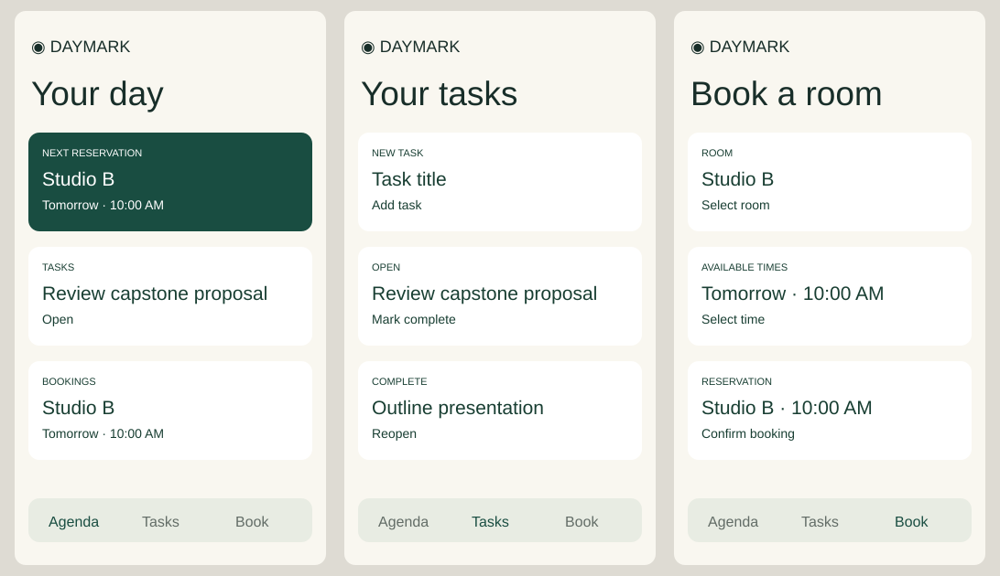

# Daymark

A cross-platform campus planner for tracking coursework and reserving study rooms. The Agenda screen brings open tasks and upcoming reservations together. Built with React Native, Expo SDK 58, TypeScript, and a Node.js REST API backed by SQLite.



[Open the editable Figma wireframes](https://www.figma.com/design/AjLdC52WLKltFXyOLhRPy2)

## Run locally

Use Node.js **24.3 or newer in the 24.x line**. From the repository root:

```sh
npm ci
cp .env.example .env
npm run api
```

Leave the API running. In a second terminal, use **one** of these commands:

| Target | Command | EXPO_PUBLIC_API_URL in .env |
| --- | --- | --- |
| Browser | `npm run web` | `http://localhost:4000` |
| iOS simulator | `npm run ios` | `http://localhost:4000` |
| Android Studio emulator | `npm run android` | `http://10.0.2.2:4000` |
| Physical phone | `npm start`, then scan the QR code with an SDK 58-compatible Expo Go | `http://YOUR_COMPUTER_LAN_IP:4000` |

For a phone, connect both devices to the same Wi-Fi and allow incoming connections to port 4000 on the computer. Restart Expo after editing the URL. The API creates its database in `data/daymark.sqlite` on first launch. Use the local browser preview if a simulator or compatible Expo Go client is unavailable.

## Try the project in two minutes

1. Open **Tasks**, add “Review capstone proposal,” then tap its checkbox to complete or reopen it.
2. Open **Book**, select a room and an hour, then confirm. **Agenda** shows the reservation in the device’s local time.
3. On a second client connected to the same API, refresh the room schedule. The reserved hour is unavailable. Cancel the booking from Agenda to release it.
4. After a successful sync, stop the API and tap **Refresh**. The cached agenda still opens, including after relaunch. Reconnect, restart the API and refresh to resume edits.

## Implementation

- **Mobile client** — Three screens share a typed agenda model. Native builds store the last successful snapshot in the app’s documents directory. The browser uses local storage. Offline viewing includes a last-sync timestamp. Edits and confirmations require a live API. The web preview needs its frontend server to load on a fresh browser visit.
- **Bookings** — Three rooms offer 60-minute reservations over a rolling 72-hour horizon. Start times range from 14:00 to 22:00 UTC. The server validates each selection and enforces a unique SQLite constraint on room and start time. Concurrent attempts return one confirmation and one HTTP 409.
- **Workspace scope** — This is a shared, local portfolio demo. Clients using the same API can edit the same tasks and bookings. Use a trusted network for the demo. An internet-facing multiuser deployment would require authentication and per-user authorization.

| Endpoint | Operation |
| --- | --- |
| GET /api/agenda | Load tasks, future bookings, rooms, and candidate times |
| POST /api/tasks | Create a task with a title |
| PATCH /api/tasks/:id | Set the boolean done field |
| DELETE /api/tasks/:id | Remove a task |
| POST /api/bookings | Reserve a room using its name and UTC start time (at) |
| DELETE /api/bookings/:id | Cancel a reservation |

## Verification and builds

```sh
npm run typecheck
npm test
npx expo export --platform all
```

GitHub Actions runs these checks on pushes and pull requests. A separate **Build native preview** workflow submits Android APK or iOS simulator builds to EAS on manual dispatch and waits for the result.

To activate the native workflow for your account:

1. From the unzipped project, run `npx eas-cli@latest login` and `npx eas-cli@latest init`. Commit the project ID added to the Expo config. Choose your own package/bundle identifiers before distributing a build.
2. Set `EXPO_PUBLIC_API_URL` in the EAS **preview** environment to a reachable HTTPS API for the intended test devices. A cloud-built app cannot reach your laptop through localhost. For a local-only demo, use Expo Go and the LAN instructions above.
3. Run the first preview build interactively for your chosen platform, e.g. `npx eas-cli@latest build --profile preview --platform android`, to complete the platform setup and credentials prompts.
4. Store an Expo access token as the GitHub Actions repository secret `EXPO_TOKEN`. From **Actions → Build native preview → Run workflow**, choose the platform. EAS returns the build link.

## Put it on GitHub

Create an empty repository named `daymark-campus-planner`. In the extracted directory (the one containing this README), run:

```sh
git init -b main
git add .
git commit -m "Build Daymark campus task and booking planner"
git remote add origin https://github.com/YOUR_USERNAME/daymark-campus-planner.git
git push -u origin main
```

The archive includes hidden files such as `.github/workflows/` and `.gitignore`. The commands above include those files and exclude local data, dependencies, and environment settings.
